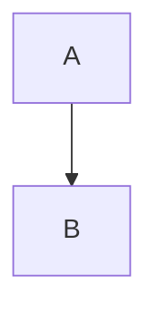

# 思源 Markdown / Kramdown 语法参考

实测环境：SiYuan kernel **3.8.2**（官方用户指南 + live API 验证）。
写文档、追加块、`updateBlock`、`insertBlock` 用到的 `markdown` 都会经过 Lute 解析；
**本文所有语法都经过 `createDocWithMd` → `getBlockKramdown` / `getBlockDOM` / `query/sql` 回读验证**。

> 官方补充资料（随仓库 docs 更新，版本可能高于 3.8.2）：
> `docs/API.zh-CN.md`、`docs/SY-FORMAT.zh-CN.md`、`docs/DOCUMENT-ADDRESSING.zh-CN.md`、
> `docs/DATABASE-SUBITEMS.zh-CN.md`、`docs/TEMPLATE-MANAGER.zh-CN.md`
> 仓库：<https://github.com/siyuan-note/siyuan/tree/master/docs>

---

## 0. 先分清两种「文本」

| 取法 | 端点 | 特点 | 用途 |
| --- | --- | --- | --- |
| 导出 Markdown | `POST /api/export/exportMdContent {id}` | 顶部带 YAML frontmatter、正文首行重复 `# 标题`、表格被压成 `\|a\|b\|`、任务统一 `[X]`、丢失 IAL | 给人看/复制、导入其它系统 |
| Kramdown 源码 | `POST /api/block/getBlockKramdown {id}` | 保留块 IAL（`{: id="..." name="..."}`）、保留超级块与嵌入块原样、属性顺序规范化 | **写入后回读校验、精确编辑** |
| 渲染 DOM | `POST /api/block/getBlockDOM {id}` | 真实节点与行级 `data-type` | 确认某个标记是否真的生效 |
| SQL | `POST /api/query/sql {stmt}` | 结构化检索；**写入后索引有数秒延迟** | 批量查询/看板 |

写入永远用 Markdown（GFM + 思源扩展），不要手写 `.sy` JSON；`.sy` 仅用于只读解析（见 `SY-FORMAT`）。

---

## 1. 标识：id / path / hpath

| 字段 | 形态 | 说明 |
| --- | --- | --- |
| `id` | `20261117171302-884qsee` | 块 ID = `yyyyMMddHHmmss` + 7 位 base36；doc ID 就是块 ID |
| `path` | `/20261117171302-884qsee.sy`、`/<父id>/<子id>.sy` | **存储路径**，`moveDocs.fromPaths` 需要这种带 `.sy` 的值 |
| `hpath` | `/父文档/子文档` | 人类可读路径（`createDocWithMd.path` 对应它） |
| `box` | `20261117171302-jbv77mh` | 所属笔记本 ID（权限审计靠它） |

- `createDocWithMd` 的 `path` 用 `/` 分层，**不存在的父文档会自动创建**；`/` 不能出现在标题里，需要时替换成全角 `／`（U+FF0F）。
- 新建文档标题取 `path` 最后一段；要让正文首块没有标题重复，正文里就别再写 `# 同名标题`（导出时仍会补一行 `# 标题`）。
- 需要「标题里带 `/`」时只能用全角 `／` 替换（内核会把 `/` 当层级）；精确控制父级可以先把父文档建好再传完整 path。
- 3.8.2 **没有** `createDocByParent` / `resolveDocPath` / `getDocPaths` / `reorderDocs`（调用返回空响应）；
  官方 master 的 `docs/API.zh-CN.md` 已收录这些新端点，升级内核后再用。

---

## 2. 行级语法（已验证生效）

| 写法 | 节点 | 备注 |
| --- | --- | --- |
| `**粗**` | `data-type="strong"` | |
| `*斜体*` / `_斜体_` | `em` | |
| `~~删除~~` | `s` | 双波浪线才是删除线 |
| `~下标~` | `sub` | **单波浪线是下标**，别和删除线混用 |
| `<u>下划线</u>` | `u` | |
| `==标记==` | `mark` | 荧光笔高亮 |
| `<sup>上标</sup>` / `<sub>下标</sub>` | `sup` / `sub` | |
| `<kbd>Ctrl</kbd>` | `kbd` | 按键样式 |
| `` `code` `` | `code` | 行内代码 |
| `$a^2+b^2$` | `inline-math` | 行内公式，`$` 之间不要留空 |
| `[文字](https://x.com)` | `a` | |
| `` | 图片 | 资源须先 `asset/upload` |
| `#标签#`、`#标签/子标签#` | `tag` | 标签是行级文本，不是块；层级用 `/` |
| `:smile:` | emoji | 冒号短名 |

不支持（会退化成普通文本，别写进文档）：

- **脚注** `[^1]` / `[^1]: 内容`
- **定义列表** `术语` + `: 定义`
- 直接给纯文本加 IAL 样式（见下节）

---

## 3. 行级样式（颜色/背景/字号）只能挂在「标记」上

正确写法（官方示例同款，IAL 紧跟标记、后面可以继续接文本）：

```markdown
**重要**{: style="color: var(--b3-font-color1);"} 普通文本
*提示*{: style="background-color: var(--b3-font-background5);"}
[链接](https://example.com){: style="color: var(--b3-font-color5);"}
```

实测结论：

- `**文本**{: style="..."}` ✅ 生效（DOM 上 `style` 落在 `<span data-type="strong">`）
- `普通文本{: style="..."}` ❌ 整串变成字面文本
- `<span style="color:red">x</span>` ❌ 行内 HTML 不解析（只有**块级** HTML 生效）
- `<span data-type="text" style="...">x</span>` ❌ 标签被剥掉、样式丢失

可用 CSS 变量：`--b3-font-color1..13`、`--b3-font-background1..13`、`--b3-font-size-*`；
也可以用普通 CSS（`color:#e93147`、`font-size:18px`）。渲染结果以思源主题为准。

---

## 4. 块级语法

### 4.1 标题与段落

```markdown
# 一级
## 二级
### 三级
###### 六级

普通段落。块之间必须用**空行**分隔，否则会被合并成同一段落（或变成软换行）。
```

标题层级上限 6；标题块在 `blocks` 表里 `type='h'`，`subtype` 为 `h1..h6`。

### 4.2 列表 / 任务列表

```markdown
- 无序
    - 二级（4 空格缩进）
        1. 三级有序

1. 有序
2. 有序

- [ ] 未完成
- [x] 已完成
```

- 缩进用 **4 空格**（Tab 也可以），2 空格在部分场景会被当成同级。
- 任务标记导出时统一成 `[X]`；`exportMdContent` 传 `preserveTaskMarkers:true` 可保留 `[/]`、`[-]`。
- 列表块 `type='l'`（`subtype='u'/'o'/'t'`），列表项 `type='i'`；任务项内含 `NodeTaskListItemMarker`。
- 列表项内的第二段内容：空行后缩进 4 空格。

### 4.3 引述 / 提示块（Callout）

```markdown
> 普通引述
> 多行内容

> [!NOTE] 提示标题
> 提示内容第一行
> 第二行
```

- 提示块类型（大小写敏感）：`NOTE`、`TIP`、`IMPORTANT`、`WARNING`、`CAUTION`。
- 解析后 `type='callout'`，`subtype` 即类型；导出时标题前会自动补一个图标（如 `✏️`）。
- 标题可省略：`> [!TIP]` 后直接跟内容。

### 4.4 代码块

````markdown
```js
console.log(1)
```

```mindmap
- 根节点
  - 子节点
```


````

- 围栏语言即高亮语言；`mindmap` 渲染脑图，`mermaid` 渲染流程图/时序图。
- `siyuan-template`（或 `template`）用于模板片段，导出时按纯文本处理。
- 代码块 `type='c'`，语言存在 `ial`/DOM 的 `data-language` 上。

### 4.5 表格

```markdown
| 左对齐 | 居中 | 右对齐 |
| :-- | :-: | --: |
| a | b | c |
```

- 对齐行必须有；列宽由思源自己管理（导出的 kramdown 会带 `colgroup="||"`）。
- 单元格里的竖线写成 `\|`；单元格内换行在 UI 里是 `Shift+Enter`，Markdown 里写成 `<br>`（会被当文本），**建议避免**。
- 表格块 `type='t'`；合并单元格的表格导出会变成 HTML 表格，尽量别用合并单元格写自动化内容。

### 4.6 数学公式

```markdown
行内 $E=mc^2$ 结束。

$$
\int_0^1 x^2 dx
$$
```

公式块 `type='m'`；`$$` 必须单独成行开始和结束。

### 4.7 分隔线 / HTML / 媒体

```markdown
---

<div class="custom">块级 HTML</div>

<iframe src="https://example.com" style="width:100%;height:360px;"></iframe>

<video src="assets/demo.mp4" controls></video>
<audio src="assets/demo.mp3" controls></audio>
```

- 块级 HTML 会保留，脚本与事件属性会被过滤；需要包裹时用 `<div>`。
- iframe/视频/音频用 HTML 直接写，`type='iframe'` / `'video'` / `'audio'`。
- 分隔线 `type='tb'`；注意它和超级块分隔符的冲突（见 4.8）。

### 4.8 超级块（横向/纵向排版）

```markdown
{{{row
左边内容

右边内容
}}}
```

- `{{{row` = 横向排布（`data-sb-layout="row"`），`{{{col` = 纵向堆叠（`col`）。
- 子块之间用**空行**分隔，最后 `}}}` 单独一行收尾；可以嵌套超级块。
- 实测坑：
  - 用 `---` 当分隔符时，`col` 能正确切成两个子块，`row` 会多出一个 **分隔线块**（`type='tb'`）——统一用空行分隔最稳。
  - `^^^` 不是分隔符，会原样留在段落里。
  - 超级块 `type='s'`，`sb_layout` 字段记录 row/col。

### 4.9 嵌入块（动态查询）

```markdown
{{SELECT * FROM blocks WHERE type='d' AND box='<notebookId>' LIMIT 5}}
```

- 必须独占一行（前后空行），解析为 `type='query_embed'`。
- 支持 `//!js` 前缀执行 JavaScript（前端上下文，脚本能力等同插件；**写文档时别用**，可读性差且不可控）。
- 查询语句语法见 `references/siyuan-api.md` 的 SQL 章节。

### 4.10 数据库块（Attribute View）

数据库是独立块类型（`type='av'`），**不能靠 Markdown 直接造出来**，必须走 API：

- 先插入块：`/api/block/insertBlock {dataType:"markdown", data:"", previousID|parentID}` 再转？❌ 不行
- 正确路径：用 `/api/av/*` 系列创建/绑定，或用模板/挂件；条目数据在 `data/storage/av/*.json`。

细节见 `references/siyuan-operations.md#数据库`。

---

## 5. 块属性（IAL）

块级 IAL 语法：属性行紧跟在块后（下一行），`{: key="value" ...}`：

```markdown
带属性的段落
{: id="20261117000000-abcdefg" name="锚点名称" alias="别名一,别名二" memo="备注" bookmark="书签" custom-progress="30" custom-owner="rogee"}
```

| 键 | 含义 | 可检索 |
| --- | --- | --- |
| `id` | 指定块 ID（需符合 `yyyyMMddHHmmss-xxxxxxx`） | ✅ |
| `name` | 命名（可作为锚文本/`((id "name"))` 的显示名） | ✅ `blocks.name` |
| `alias` | 别名，逗号分隔 | ✅ `blocks.alias` |
| `memo` | 备注（不影响正文渲染） | ✅ `blocks.memo` |
| `bookmark` | 书签标签 | ✅ |
| `custom-*` | 自定义属性，名字必须小写字母开头 | ✅ `attributes` 表 |
| `style` | 块级样式（如 `text-align:center`） | ✅ |
| `fold` | `fold="1"` 折叠 | ✅ |

限制（实测）：

- 自定义属性会被强制加 `custom-` 前缀并存进 `attributes` 表：`select * from attributes where block_id='<id>'`。
- 行级 IAL 只能附在行内**标记**后（见第 3 节），附在纯文本后不生效。
- **文档级属性不能在正文 IAL 里设置**（`title`、`custom-*` 写在文档末尾 IAL 会被忽略）；文档属性必须用
  `POST /api/attr/setBlockAttrs {id: <docId>, attrs: {"custom-x":"1"}}`，或用 `createDocByParent` 的 `tags` 等参数（仅新版本内核）。
- 同一个块多个 IAL 只有最后一个生效；属性顺序在 `getBlockKramdown` 会被规范化（`id` → `updated` → 其它）。

---

## 6. 引用体系

### 6.1 块引用

```markdown
静态锚文本：((20261117171302-884qsee "语法验证"))
动态锚文本：((20261117171302-884qsee '该块的最新内容'))
```

- 双引号 = 静态锚文本（冻结显示文字）；单引号 = 动态锚文本（随目标块内容变化）。
- 也可以只写 `((id))`，显示块内容。
- `[[` 只搜文档标题，`((` 搜块。
- 反向链接（谁引用了我）：`POST /api/ref/getBacklink {id}`；相关端点还有 `getGlobalBacklinks`、`getGlobalBacklinkContexts`。

### 6.2 块超链接（siyuan:// 协议）

```markdown
[跳到某块](siyuan://blocks/20261117171302-884qsee)
[聚焦打开](siyuan://blocks/20261117171302-884qsee?focus=1)
[全屏打开](siyuan://blocks/20261117171302-884qsee?fullscreen=1)
```

用于本地跳转，不依赖网络；在导出/分享场景下对方不一定能打开。

### 6.3 标签 vs 引用

| | 标签 `#标签#` | 块引用 `((id "x"))` |
| --- | --- | --- |
| 粒度 | 行内文本 | 块 |
| 检索 | `searchTag` / SQL `blocks.tag` | `refs` 表 / `getBacklink` |
| 重命名 | `POST /api/tag/renameTag` | 无法批量重命名锚文本 |

---

## 7. 序列化差异（写文档前必看）

`exportMdContent` 的输出与源码不一致，做「读-改-写」时**不要用导出文本回写**：

| 现象 | 原因 |
| --- | --- |
| 正文开头多一行 `# 标题` | 导出会补文档标题 |
| 顶部 YAML frontmatter `title/date/lastmod` | 导出元数据，写回会变成正文 |
| 表格变成 `\|a\|b\|c\|` 紧凑形式 | 导出压缩 |
| 任务列表 `[X]` 大写 | 导出归一化（可用 `preserveTaskMarkers`） |
| 超级块 `{{{row` 变成子块平铺 + `---` | 导出展开布局 |
| 所有 `{: id=... }` 消失 | 导出剥离 IAL |

安全做法：

1. 读结构 → 用 `getBlockKramdown`；
2. 只改需要改的块 → `updateBlock {id, dataType:"markdown", data}`（会把该块整块替换），或 `appendBlock` / `insertBlock` 增量写；
3. 回读 `getBlockKramdown` 校验。

---

## 8. 易错清单（都是实测踩过的）

| 写法 | 结果 | 正确写法 |
| --- | --- | --- |
| `~文字~` 想表示删除线 | 变成下标 `sub` | `~~文字~~` |
| `[^1]` 脚注 | 原样文本 | 用「备注」块属性或行内括号说明 |
| `术语` + `: 定义` | 普通段落 | 用列表或表格 |
| 纯文本 + `{: style=...}` | 字面文本 | 先套 `**...**` 等标记 |
| `{{{row ... --- ... }}}` | 多一个分隔线块 | 子块之间用空行 |
| 正文末 `{: title="x"}` | 被忽略 | `setBlockAttrs` 设置文档属性 |
| 段落之间只有一个换行 | 合并为一段 | 空行分隔 |
| 写完后立刻 `query/sql` 查不到 | SQL 索引延迟数秒 | sleep 2s 或直接 `getBlockKramdown` |
| `moveDocs` 传 `fromIDs` | 内核 panic、静默失败 | 传 `fromPaths`（见 operations 文档） |
| `#标签#` 写在标题里 | 标题文本按字面处理 | 标签单独成段/行内文本 |

---

## 9. 自检配方

```bash
# 1) 看某个块的真实解析结果
curl -s -X POST "$SIYUAN_API_URL/api/block/getBlockKramdown" \
  -H "Authorization: Token $SIYUAN_TOKEN" -H 'Content-Type: application/json' \
  -d '{"id":"<blockId>"}' | jq -r '.data.kramdown'

# 2) 看行级标记是否生效
curl -s -X POST "$SIYUAN_API_URL/api/block/getBlockDOM" \
  -H "Authorization: Token $SIYUAN_TOKEN" -H 'Content-Type: application/json' \
  -d '{"id":"<blockId>"}' | jq -r '.data.dom'

# 3) 结构化核对类型/属性
curl -s -X POST "$SIYUAN_API_URL/api/query/sql" \
  -H "Authorization: Token $SIYUAN_TOKEN" -H 'Content-Type: application/json' \
  -d '{"stmt":"select id,type,subtype,content from blocks where root_id=\"<docId>\" order by sort"}' | jq
```

用本仓库 CLI 更省事：

```bash
scripts/siyuan.py read <docId>            # 导出 Markdown（给人看）
scripts/siyuan.py sql "select id,type,subtype from blocks where root_id='<docId>'"
```
